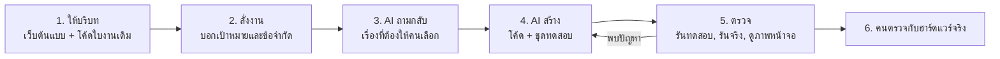

# บันทึกการพัฒนาด้วย AI

โปรเจกต์นี้พัฒนาโดยใช้ AI เป็นผู้ช่วย บันทึกนี้เก็บว่าแต่ละขั้น **สั่ง AI ว่าอะไร** AI ทำอะไร และ **ตรวจผลอย่างไร**
เพื่อให้ผู้เรียนเห็นวิธีทำงานร่วมกับ AI ที่ตรวจสอบได้ ไม่ใช่แค่คัดลอกโค้ดมาใช้

| รายการ | ค่า |
| --- | --- |
| ผู้ช่วย AI | Claude (claude.ai) — โมเดลที่ตั้งค่าในเซสชัน: `claude-opus-5-5` |

## วิธีทำงานกับ AI ที่ใช้ตลอดโปรเจกต์

## บันทึกรายขั้น

### ขั้นที่ 1 · ศึกษาเว็บต้นแบบ

**คำสั่ง:** "คุณสามารถเข้าศึกษาเนื้อหาที่เว็บ https://vsupacha.github.io/aiot-for-beginners/ นี้ได้ไหม ถ้าได้ให้เพิ่มเป็นแหล่งข้อมูลที่ต้องใช้ในการทำงานอื่น ๆ ต่อไป"

**AI ทำ:** อ่านหน้าหลัก หน้า Gateway หน้าตั้งค่าระบบ หน้า AI และหน้าความปลอดภัย แล้วสรุปสถาปัตยกรรม (บอร์ด → gateway HTTP → แชท Streamlit, Gemma แปลคำสั่ง) และหลัก "AI เสนอ ระบบตัดสิน"

**ตรวจ:** เทียบสรุปกับหน้าเว็บจริง และให้ AI ชี้ส่วนที่เว็บต้นแบบ**ไม่มี** (ไม่ใช้ MQTT ไม่ใช้ Docker ไม่ได้พูดถึงบอร์ด Cucumber) เพื่อไม่ให้ตีความเกินจริง

### ขั้นที่ 2 · รับโจทย์และตัดสินใจเรื่องที่ต้องให้คนเลือก

**คำสั่ง:** โจทย์ project 5 ข้อ — deploy บน GitHub Pages, ใช้บอร์ด Cucumber, เลือกที่รัน AI, เลือก UI, เลือกกลุ่มเป้าหมาย

**AI ทำ:** ถามกลับ 4 เรื่องที่ AI ไม่ควรเลือกเอง เพราะเปลี่ยนทั้งเนื้อหาและโค้ด

| คำถาม | ที่เลือก |
| --- | --- |
| กลุ่มเป้าหมายและสถานการณ์ | อุตสาหกรรม: เฝ้าระวังเครื่องจักร |
| AI รันที่ไหน | PC แบบ local |
| UI | Telegram |
| GitHub | สร้าง repo เปล่าแล้วให้ AI push |

### ขั้นที่ 3 · ออกแบบระบบ

**AI เสนอ:** วัดการสั่นด้วย MPU-6050 → RMS/peak ทุก 1 วินาที → MQTT → gateway เรียนรู้ค่าปกติแล้วตัดสินด้วยกฎ → ไฟ RGB และ Telegram
ให้ Gemma (ผ่าน Ollama ใน Docker) ทำแค่แปลข้อความเป็นคำสั่งใน allowlist ตามหลักของเว็บต้นแบบ

**ตรวจ:** ตรวจว่าแต่ละส่วนต่อยอดจากใบงานที่ทำมาแล้ว (MQTT จากใบงาน 4, REST + Docker จากใบงาน 5, บอทจากใบงาน 6, Mini App + Dev Tunnel จากใบงาน 9) จึงอธิบายและแก้ไขเองได้

### ขั้นที่ 4 · Gateway, กฎ และชุดทดสอบ

**AI ทำ:** เขียน `rules.py` (debounce + hysteresis), `commands.py` (allowlist), `llm.py`, `security.py` และชุดทดสอบ 41 ข้อ

**ตรวจ:** รัน `python -m pytest` — รอบแรก**ไม่ผ่าน 1 ข้อ** ประโยค "ลดความไวลง" ถูกแปลเป็น `none`
สาเหตุ: โค้ดลบคำว่า "ความไว" ออกก่อนหาระดับ ทำให้คำว่า "ลดความไว" หายไป แก้แล้วผ่านครบ 41 ข้อ

!!! note "บทเรียน"
    ชุดทดสอบที่เขียนจาก "ประโยคที่คนจะพิมพ์จริง" จับข้อผิดพลาดที่ AI ทำเองได้ ถ้าไม่มีชุดทดสอบ ข้อผิดพลาดนี้จะไปโผล่ตอนใช้งานจริง

### ขั้นที่ 5 · ทดสอบทั้งระบบด้วยตัวจำลอง

**AI ทำ:** รัน MQTT broker, gateway และตัวจำลองจริงในเครื่อง แล้วไล่ทุกสถานะ

**ตรวจ:** สั่ง "เรียนรู้ค่าปกติใหม่" → ได้ baseline 0.248 m/s² เกณฑ์ 0.50 / 0.99 → เปลี่ยนตัวจำลองเป็นโหมดชำรุด → สถานะเป็น "อันตราย" หลังเกินเกณฑ์ติดกัน 3 ครั้ง ตรงตามที่ออกแบบ

### ขั้นที่ 6 · แดชบอร์ด Mini App

**AI ทำ:** สร้างแดชบอร์ด แล้วถ่ายภาพหน้าจอทั้งโหมดสว่างและมืดเพื่อตรวจ

**ตรวจจากภาพหน้าจอ แล้วแก้ 4 จุด:**

1. กราฟลากเส้นตรงยาวข้ามช่วงที่บอร์ดหลุด → แก้ให้ตัดเส้นเมื่อข้อมูลขาดเกิน 5 วินาที
2. เปิดแดชบอร์ดนอก Telegram ไม่ได้เลยเมื่อเปิดระบบยืนยันตัวตน → เพิ่มช่องใส่ `API_KEY` สำหรับจอในห้องควบคุม
3. หน้า `/docs` ใส่ API key ไม่ได้ → ประกาศ `APIKeyHeader` ให้มีปุ่ม Authorize
4. ภาพหน้าจอของข้อ 2 แสดงทั้งช่องใส่คีย์และแดชบอร์ดว่าง ๆ พร้อมกัน ทั้งที่โค้ดสั่งซ่อนไว้แล้ว
   สาเหตุ: CSS `display: grid` ทับ attribute `hidden` ของ HTML → เพิ่มกฎ `[hidden] { display: none !important; }`

!!! note "บทเรียน"
    ข้อ 4 ไม่มีชุดทดสอบตัวไหนจับได้ เพราะ JavaScript ทำงานถูกต้องทุกบรรทัด ต้อง**ดูภาพหน้าจอจริง**จึงเห็น

### ขั้นที่ 7 · เฟิร์มแวร์

**AI ทำ:** เขียนเฟิร์มแวร์ PlatformIO อ่าน MPU-6050 ที่ 200 Hz คำนวณ RMS ด้วย `double` ต่อ MQTT แบบไม่หยุดการวัด และมีกฎสำรองตอนออฟไลน์

**ตรวจ:** สภาพแวดล้อมของ AI ดาวน์โหลด toolchain ของ PlatformIO ไม่ได้ จึง**คอมไพล์ในเครื่องของ AI ไม่ได้**
แก้โดยให้ GitHub Actions คอมไพล์ทุกครั้งที่ push และต้องทดสอบกับบอร์ดจริงอีกครั้ง (ดูรายการด้านล่าง)

### ขั้นที่ 8 · เว็บไซต์สอน

**AI ทำ:** เขียนบทเรียน 8 บท หน้าแก้ปัญหา หน้าผู้สอน 3 หน้า ด้วย MkDocs และตั้ง GitHub Actions ให้ deploy ขึ้น GitHub Pages

**ตรวจ:** `mkdocs build --strict` ต้องไม่มีลิงก์เสีย และเปิดดูภาพหน้าจอของเว็บ

### ขั้นที่ 9 · ขึ้น GitHub และ GitHub Pages 

**คำสั่ง:** ส่งลิงก์ repo `https://github.com/wchotichai-pp/aiot_machine_health.git` และเชื่อมบัญชี GitHub กับ Claude

**AI ทำ:** แก้ลิงก์ในเว็บและ README ให้ตรงกับชื่อ repo ตรวจว่าไม่มี `.env`, `secrets.h` หรือฐานข้อมูลติดไปใน commit แล้ว push

**ตรวจ:** ดูผล GitHub Actions

| งาน | ผล |
| --- | --- |
| ชุดทดสอบ gateway | ผ่าน |
| คอมไพล์เฟิร์มแวร์ด้วย PlatformIO | ผ่าน — ยืนยันว่าเฟิร์มแวร์จากขั้นที่ 7 คอมไพล์ได้จริง |
| ตรวจไวยากรณ์บอทและตัวจำลอง | ผ่าน |
| Deploy เว็บ รอบแรก | ไม่ผ่าน เพราะยังไม่ได้เปิด GitHub Pages ใน Settings |
| Deploy เว็บ หลังเจ้าของ repo เปิด Pages | ผ่าน |

!!! note "บทเรียน"
    การเปิด GitHub Pages ต้องใช้สิทธิ์เจ้าของ repo AI จึงทำแทนไม่ได้ ต้องให้คนกดเอง แล้วให้ AI สั่ง deploy ใหม่

### ขั้นที่ 10 · หน้าเดโมบน GitHub Pages

**ที่มา:** ให้ AI วิเคราะห์ว่าโจทย์ project ตีความได้กี่แบบ AI ชี้ว่าผู้ตรวจอาจเปิดลิงก์ project แล้วคาดว่าจะ**เห็นระบบทำงาน** แต่ตอนนั้นเว็บมีแค่เอกสาร เพราะแดชบอร์ดตัวจริงรันบน PC

**คำสั่ง:** "เพิ่มส่วนที่ต้องทำเพิ่ม เพราะบทพูดจะพูดถึงสิ่งที่ยังไม่มี"

**AI ทำ:** สร้าง[หน้าเดโม](https://wchotichai-pp.github.io/aiot_machine_health/demo/) ที่ใช้**แดชบอร์ดตัวจริง**จาก `gateway/static` โดยไม่แก้โค้ดแดชบอร์ดเลย
แล้วเพิ่มไฟล์ `demo/demo-mock.js` ที่จำลองเครื่องจักรและ API ในเบราว์เซอร์ กฎตัดสินสถานะแปลงมาจาก `gateway/app/rules.py` ใช้ค่าเริ่มต้นชุดเดียวกัน
ตอน deploy GitHub Actions จะคัดลอกแดชบอร์ดมารวมกับไฟล์จำลองนี้เอง (`demo/build_demo.sh`) แดชบอร์ดจึงมีแหล่งโค้ดเดียว ไม่ต้องดูแลสองชุด

**ตรวจ:** เปิดหน้าเดโมด้วยเบราว์เซอร์อัตโนมัติขนาดจอมือถือ แล้วกดทุกปุ่ม

| ทดสอบ | ผล |
| --- | --- |
| เปิดหน้า | สถานะปกติ, กราฟมีข้อมูลย้อนหลัง 3 นาที, ไม่มี error |
| กด "เสียสมดุล" | สถานะเป็นเฝ้าระวังภายในไม่กี่วินาที |
| กด "ชำรุด" | สถานะเป็นอันตราย พร้อมเหตุผลและตัวเลข |
| ปุ่มเรียนรู้ค่าปกติ / ซ่อมบำรุง / กลับมาเฝ้าระวัง / ความไวสูง | ทำงานครบ เกณฑ์เปลี่ยนเป็น 0.38 / 0.75 m/s² ตามที่คำนวณ |
| จอกว้าง 390 px | ไม่มีการเลื่อนแนวนอน |

!!! note "บทเรียน"
    AI ช่วยหา "ช่องว่างระหว่างสิ่งที่ทำกับสิ่งที่ผู้ตรวจอาจคาดหวัง" ได้ แต่คนต้องเป็นคนตัดสินใจว่าจะปิดช่องไหน

## สิ่งที่คนต้องตรวจเอง (AI ตรวจแทนไม่ได้)

- [ ] อัปโหลดเฟิร์มแวร์ลงบอร์ด Cucumber จริง และดู Serial Monitor ตามบทที่ 5
- [ ] ค่า RMS ตอนบอร์ดวางนิ่งบนโต๊ะ (ควรต่ำกว่า 0.1 m/s²) และตอนติดบนพัดลม
- [ ] ไฟ RGB เปลี่ยนสีตามสถานะจริง
- [ ] ทดสอบกับโมเดล Gemma จริงผ่าน Ollama (AI ทดสอบส่วนนี้ด้วยคำตอบจำลองเท่านั้น) และกรอกตารางเทียบ AI กับกฎในบทที่ 7
- [ ] บอทตอบใน Telegram, แจ้งเตือนเข้า, ปุ่ม Dashboard เปิด Mini App ได้ผ่าน Dev Tunnel
