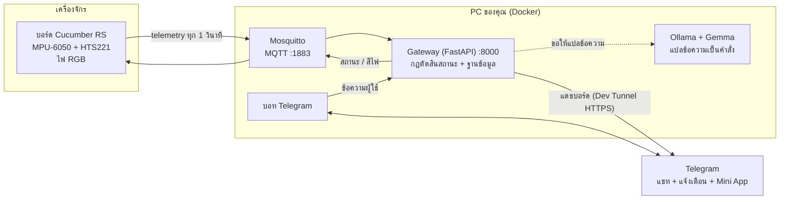

# AIoT เฝ้าระวังเครื่องจักร

ชุดเรียนรู้ AIoT สำหรับ**ช่างซ่อมบำรุง วิศวกร และผู้ดูแลไลน์ผลิต** ผู้เรียนจะสร้างระบบเฝ้าระวังการสั่นสะเทือนของเครื่องจักรขนาดเล็กด้วยตัวเอง
ติดบอร์ด Cucumber บนมอเตอร์ พัดลม หรือปั๊ม ให้ระบบเรียนรู้ว่า "ปกติ" สั่นแค่ไหน แล้วแจ้งเตือนผ่าน Telegram เมื่อเริ่มผิดปกติ
คุยกับระบบเป็นภาษาไทยได้ โดยมี AI ที่รันบน PC ของคุณเองช่วยแปลข้อความเป็นคำสั่ง

!!! info "ชุดเรียนรู้นี้ต่อยอดจาก"
    [AIoT for Beginners](https://vsupacha.github.io/aiot-for-beginners/) (โคมไฟอัจฉริยะ) ของ ผศ.ดร.ศุภชัย วรพจน์พิศุทธิ์
    โดยยึดหลักเดียวกันคือ **"AI เสนอ ระบบตัดสิน"** แต่เปลี่ยนโจทย์เป็นงานซ่อมบำรุงในโรงงาน

## ระบบทำงานอย่างไร



| ส่วน | หน้าที่ | ตัดสินใจเองไหม |
| --- | --- | --- |
| บอร์ด Cucumber | วัดการสั่น 200 ครั้ง/วินาที สรุปเป็นค่า RMS และ peak ทุก 1 วินาที แสดงสีไฟตามที่ gateway สั่ง | เฉพาะตอนติดต่อ gateway ไม่ได้ |
| Gateway | เรียนรู้ค่าปกติ เทียบเกณฑ์ ยืนยันซ้ำก่อนเปลี่ยนสถานะ เก็บประวัติ | **ใช่ — เป็นผู้ตัดสินหลัก** |
| AI (Gemma บน PC) | แปลข้อความ เช่น "จะเปลี่ยนลูกปืน ปิดแจ้งเตือน 1 ชั่วโมง" เป็น JSON คำสั่ง | ไม่ — เลือกได้แค่คำสั่งใน allowlist |
| Telegram | แชทสั่งงาน รับแจ้งเตือน เปิดแดชบอร์ด | ไม่ |

## สถานะและสีไฟ

| สีไฟ | สถานะ | ความหมาย |
| --- | --- | --- |
| <span class="state-dot green"></span>เขียว | ปกติ | การสั่นต่ำกว่าเกณฑ์เฝ้าระวัง |
| <span class="state-dot yellow"></span>เหลือง | เฝ้าระวัง | สั่นเกิน 2 เท่าของค่าปกติ (ค่าเริ่มต้น) ติดกัน 3 วินาที |
| <span class="state-dot red"></span>แดง | อันตราย | สั่นเกิน 4 เท่าของค่าปกติ หรืออุณหภูมิเกิน 55 °C ติดกัน 3 วินาที |
| <span class="state-dot white"></span>ขาว | กำลังเรียนรู้ | เก็บค่าปกติ 30 วินาที ห้ามแตะเครื่อง |
| <span class="state-dot blue"></span>น้ำเงิน | ซ่อมบำรุง | ปิดแจ้งเตือนชั่วคราวระหว่างซ่อม |
| <span class="state-dot purple"></span>ม่วง | ออฟไลน์ | บอร์ดติดต่อ gateway ไม่ได้ ใช้กฎสำรองในบอร์ด |

## เริ่มเรียน

<div class="grid cards" markdown>

- **ผู้เรียน** — เริ่มที่ [1. AIoT ในงานซ่อมบำรุง](learn/01-aiot-in-industry.md) แล้วไล่ตามลำดับ ใช้เวลาประมาณ 3 ชั่วโมง
- **ยังไม่มีบอร์ด** — ข้ามบทที่ 5 ไปก่อน ใช้ [ตัวจำลองเครื่องจักร](learn/04-run-system.md#simulator) แทนได้ทุกบท
- **ผู้สอน** — ดู [แผนการสอน](instructor/lesson-plan.md) และ [สถาปัตยกรรมและ API](instructor/architecture.md)
- **อยากรู้ว่าสร้างด้วย AI อย่างไร** — ดู [บันทึกการพัฒนาด้วย AI](ai-dev-log.md)

</div>

## สิ่งที่ต้องมี

- PC Windows/macOS/Linux ที่ติดตั้ง Docker Desktop ได้ และมี RAM อย่างน้อย 8 GB
- บอร์ด Cucumber RS (ESP32-S2) 1 บอร์ดต่อผู้เรียน พร้อมสาย USB (ไม่บังคับ ใช้ตัวจำลองแทนได้)
- เครื่องจักรขนาดเล็กสำหรับทดลอง เช่น พัดลมตั้งโต๊ะ และเทปกาวสองหน้าหรือเคเบิลไทร์
- บัญชี Telegram และ WiFi 2.4 GHz วงเดียวกันระหว่างบอร์ดกับ PC

## โครงสร้าง repo

```text
aiot_machine_health/
├── firmware/cucumber_vibration/   เฟิร์มแวร์บอร์ด (PlatformIO)
├── gateway/                       FastAPI: กฎ, ฐานข้อมูล, MQTT, API, แดชบอร์ด Mini App
│   ├── app/rules.py               ← กฎตัดสินสถานะ (ส่วนที่สำคัญที่สุด)
│   ├── app/commands.py            ← allowlist คำสั่ง + ตัวแปลด้วยกฎ
│   ├── app/llm.py                 ← เรียก Gemma ผ่าน Ollama
│   └── tests/                     ← ชุดทดสอบ
├── bot/                           บอท Telegram
├── simulator/                     ตัวจำลองเครื่องจักร
├── mosquitto/                     ค่าตั้ง MQTT broker
├── docs/                          เว็บไซต์นี้ (MkDocs)
├── docker-compose.yml
└── .env.example
```
