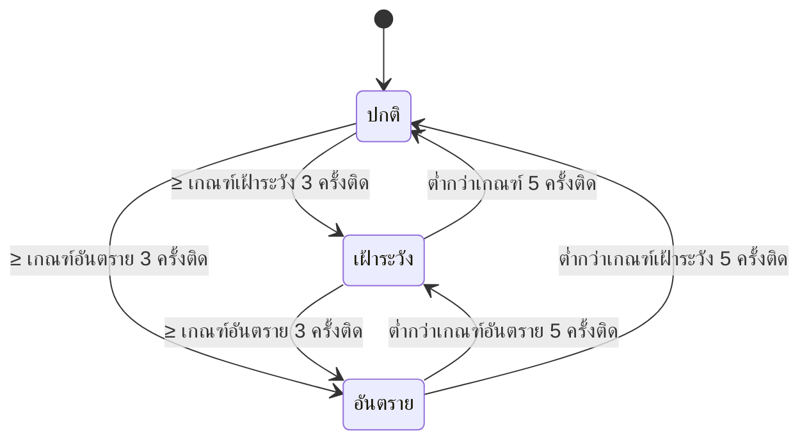

# 2. การสั่นสะเทือนเบื้องต้น

**เป้าหมายของบท:** รู้ว่าบอร์ดวัดอะไร คำนวณค่า RMS และ peak อย่างไร และทำไมต้อง "เรียนรู้ค่าปกติ" ก่อนตั้งเกณฑ์

## เซ็นเซอร์บนบอร์ด Cucumber RS

| เซ็นเซอร์ | วัดอะไร | ที่อยู่ I2C | ใช้ในระบบนี้ |
| --- | --- | --- | --- |
| MPU-6050 | ความเร่ง 3 แกน + ไจโร | 0x68 | การสั่น (ใช้เฉพาะความเร่ง ช่วง ±4 g) |
| HTS221 | อุณหภูมิ ความชื้น | 0x5F | อุณหภูมิรอบบอร์ด |
| BMP280 | ความกดอากาศ | 0x76 | ไม่ได้ใช้ |
| WS2812B (GPIO18) | ไฟ RGB | — | แสดงสถานะ |

ขา I2C ของบอร์ดนี้คือ SDA = GPIO41 และ SCL = GPIO40 ต้องสั่ง `Wire.begin(41, 40)` เอง

## จากความเร่งดิบเป็นตัวเลขตัวเดียว

เครื่องวัดความเร่งเห็นทั้ง**แรงโน้มถ่วง** (คงที่ประมาณ 9.81 m/s²) และ**การสั่น** (ค่าที่แกว่งไปมา) รวมกัน
บอร์ดเก็บค่า 200 ครั้งใน 1 วินาที แล้วทำ 3 ขั้นตอน

1. **หาค่าเฉลี่ยของแต่ละแกน** \(\bar{a}_x, \bar{a}_y, \bar{a}_z\) — คือแรงโน้มถ่วงตามท่าที่ติดบอร์ด
2. **ตัดค่าเฉลี่ยออก** เหลือแต่ส่วนที่สั่น
3. **รวมพลังงานการสั่นทั้ง 3 แกน** เป็นค่า RMS

\[
a_{\text{RMS}} = \sqrt{\sigma_x^2 + \sigma_y^2 + \sigma_z^2},
\qquad
\sigma_x^2 = \frac{1}{N}\sum_{i=1}^{N} a_{x,i}^2 - \bar{a}_x^2
\]

**Peak** คือขนาดของการสั่นที่มากที่สุดในหน้าต่างนั้น (เทียบกับค่าเฉลี่ยของหน้าต่างก่อนหน้า)
อัตราส่วน peak ÷ RMS เรียกว่า **crest factor** ถ้าสั่นสม่ำเสมอจะอยู่ราว 3 ถ้ามีการกระแทกเป็นจังหวะ เช่น ลูกปืนมีรอย จะสูงขึ้น

??? note "ดูโค้ดส่วนนี้ในเฟิร์มแวร์"
    ฟังก์ชัน `finishWindow()` ใน `firmware/cucumber_vibration/src/main.cpp`
    ใช้ตัวแปร `double` เพราะต้องลบเลขที่ใกล้กันมาก (ราว 96 ลบ 96) ถ้าใช้ `float` ทศนิยมจะหายจนค่าการสั่นเพี้ยน

## ทำไม 200 ครั้งต่อวินาที

ตามทฤษฎีการสุ่มตัวอย่าง (Nyquist) การวัด 200 ครั้งต่อวินาทีเห็นความถี่ได้ไม่เกิน 100 Hz
บอร์ดจึงตั้งตัวกรองในชิป MPU-6050 ไว้ที่ 94 Hz เพื่อตัดความถี่ที่สูงกว่านั้นไม่ให้มาหลอกเป็นความถี่ต่ำ (aliasing)

| ตัวอย่างเครื่อง | ความเร็วรอบ | ความถี่หลัก (1×) |
| --- | --- | --- |
| มอเตอร์ 4 ขั้ว 50 Hz | ~1,450 รอบ/นาที | ~24 Hz |
| มอเตอร์ 2 ขั้ว 50 Hz | ~2,900 รอบ/นาที | ~48 Hz |
| พัดลมตั้งโต๊ะ | ~1,000–1,400 รอบ/นาที | ~17–23 Hz |

ความถี่หลักและฮาร์มอนิกลำดับต่ำของเครื่องเหล่านี้อยู่ในช่วงที่วัดได้ อาการอย่างเสียสมดุล (ขึ้นที่ 1×) จึงตรวจได้ดี

## ทำไมต้องเรียนรู้ค่าปกติ

เครื่องแต่ละตัวสั่นไม่เท่ากัน และขึ้นกับว่าติดบอร์ดตรงไหนด้วย ตัวเลขเดียวกันอาจปกติสำหรับปั๊มตัวหนึ่ง แต่ผิดปกติสำหรับอีกตัว
ระบบจึงเก็บค่า RMS ช่วงที่เครื่องทำงานปกติ 30 ค่า แล้วใช้**ค่ามัธยฐาน**เป็นค่าปกติ (baseline) มัธยฐานไม่เพี้ยนแม้มีค่ากระชาก 1–2 ครั้ง

\[
\text{เกณฑ์เฝ้าระวัง} = k_{\text{warn}} \times \text{baseline}, \qquad
\text{เกณฑ์อันตราย} = k_{\text{alarm}} \times \text{baseline}
\]

| ระดับความไว | \(k_{\text{warn}}\) | \(k_{\text{alarm}}\) |
| --- | --- | --- |
| ต่ำ | 2.5 | 5.0 |
| ปกติ (ค่าเริ่มต้น) | 2.0 | 4.0 |
| สูง | 1.5 | 3.0 |

เกณฑ์เฝ้าระวังมีค่าต่ำสุด 0.15 m/s² กันกรณีเครื่องนิ่งมากจน baseline ใกล้ศูนย์และสัญญาณรบกวนของเซ็นเซอร์ทำให้แจ้งเตือนมั่ว

## ต้องเกินเกณฑ์ "ติดกัน" ก่อนเปลี่ยนสถานะ

ค่าที่เกินเกณฑ์ครั้งเดียวอาจเป็นแค่คนเดินชนโต๊ะ ระบบจึงใช้การยืนยันซ้ำ (debounce)

- เกินเกณฑ์**ติดกัน 3 ครั้ง** (3 วินาที) จึงเพิ่มสถานะ
- กลับมาปกติ**ติดกัน 5 ครั้ง** จึงลดสถานะ การลดช้ากว่าการเพิ่มช่วยกันไฟกะพริบไปมา (hysteresis)

## แบบฝึกหัด

1. ถ้า baseline = 0.20 m/s² และตั้งความไว "สูง" เกณฑ์เฝ้าระวังและอันตรายเป็นเท่าไร
2. ทำไมการเรียนรู้ค่าปกติตอนเครื่อง**มีปัญหาอยู่แล้ว**จึงอันตราย
3. ค่า RMS เท่าเดิม แต่ peak สูงขึ้นเรื่อย ๆ น่าจะบอกอะไร

??? success "เฉลย"
    1. เฝ้าระวัง 1.5 × 0.20 = 0.30 m/s² · อันตราย 3.0 × 0.20 = 0.60 m/s²
    2. ระบบจะจำอาการเสียเป็น "ปกติ" และตั้งเกณฑ์สูงเกินไป อาการที่แย่ลงอีกเล็กน้อยจะไม่ถูกแจ้ง
    3. crest factor สูงขึ้น แปลว่ามีแรงกระแทกเป็นช่วง ๆ ซึ่งเป็นลักษณะที่มักพบในลูกปืนหรือเฟืองที่เริ่มเสียหาย ควรตรวจหน้างาน

**ถัดไป:** [3. เตรียมเครื่องมือ](03-setup.md)
