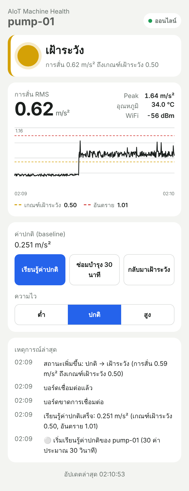

# 4. เปิดระบบด้วย Docker

**เป้าหมายของบท:** เปิด MQTT broker, gateway, AI และบอทด้วยคำสั่งเดียว แล้วป้อนข้อมูลจากตัวจำลองจนเห็นสถานะเปลี่ยน

## 1. ตั้งค่าไฟล์ .env

```bash
cp .env.example .env
```

Windows PowerShell ใช้ `copy .env.example .env` แล้วเปิด `.env` ใน VS Code แก้อย่างน้อย 1 ค่า

```ini
API_KEY=ตั้งเป็นข้อความยาวแบบสุ่ม
```

ค่า Telegram ยังเว้นว่างได้ บทที่ 6 จะกลับมาตั้ง

!!! danger "ห้ามอัปโหลด .env ขึ้น GitHub"
    ไฟล์นี้เก็บ token และรหัสลับ repo นี้ใส่ `.env` ไว้ใน `.gitignore` แล้ว อย่าลบออก

## 2. เปิดระบบ

```bash
docker compose up -d --build
```

ครั้งแรกจะดาวน์โหลด image และโมเดล Gemma (`gemma3:1b` ประมาณ 1 GB) ใช้เวลาหลายนาที ดูความคืบหน้าได้ด้วย

```bash
docker compose logs -f model-init
```

เมื่อเห็น `success` แปลว่าโมเดลพร้อมแล้ว กด `Ctrl+C` เพื่อออกจากหน้า log (ระบบยังทำงานต่อ)

## 3. ตรวจว่าทุกส่วนทำงาน

```bash
docker compose ps
```

ต้องเห็น `mosquitto`, `ollama`, `gateway`, `bot` สถานะ running ส่วน `model-init` จะจบการทำงาน (exited) หลังดาวน์โหลดเสร็จ ซึ่งถูกต้อง

เปิด <http://localhost:8000/api/health> ต้องได้ประมาณนี้

```json
{"ok": true, "mqtt_connected": true, "translator": "ollama", "model": "gemma3:1b", "model_ready": true, "auth": "on"}
```

| ช่อง | ถ้าไม่ตรง |
| --- | --- |
| `mqtt_connected: false` | ดู `docker compose logs mosquitto` |
| `model_ready: false` | โมเดลยังดาวน์โหลดไม่เสร็จ ดู `docker compose logs model-init` |

## 4. ปล่อยข้อมูลจากตัวจำลอง {#simulator}

เปิด Terminal ใหม่ แล้วรัน

```bash
python simulator/simulate_machine.py
```

ตัวจำลองส่งข้อความแบบเดียวกับบอร์ดจริงทุกประการ และพิมพ์สีไฟที่ gateway สั่งกลับมา

```text
→ [normal   ] seq=3     rms=0.249 peak=0.727 temp=31.0
   ← gateway: 🟢 normal      การสั่น 0.25 m/s² ต่ำกว่าเกณฑ์เฝ้าระวัง 1.00
```

ตัวเลือกที่ใช้บ่อย

| คำสั่ง | จำลองอะไร |
| --- | --- |
| `--mode normal` | เครื่องปกติ (ค่าเริ่มต้น) |
| `--mode imbalance` | เสียสมดุล สั่นมากขึ้นราว 2.6 เท่า |
| `--mode fault` | ชำรุด สั่นราว 5.5 เท่า มีกระชาก และร้อนขึ้น |
| `--demo` | วน ปกติ → เสียสมดุล → ชำรุด → ปกติ อัตโนมัติ |
| `--device fan-02` | ตั้งชื่อเครื่อง (จำลองหลายเครื่องพร้อมกันได้) |
| `--host 192.168.1.10` | ส่งไปยัง broker บนเครื่องอื่น |

## 5. เปิดแดชบอร์ดบนคอมพิวเตอร์

เปิด <http://localhost:8000> แล้วใส่ค่า `API_KEY` จากไฟล์ `.env` จะเห็นสถานะ กราฟการสั่น 10 นาทีล่าสุด และปุ่มสั่งงาน

{ width="360" }

## 6. ลองให้สถานะเปลี่ยน

1. ปล่อยตัวจำลองแบบ `normal` ไว้ แล้วกด **เรียนรู้ค่าปกติ** ในแดชบอร์ด ไฟเป็นสีขาว 30 วินาที แล้วกลับเป็นเขียว
2. หยุดตัวจำลอง (`Ctrl+C`) แล้วรันใหม่ด้วย `--mode imbalance` ภายในไม่กี่วินาทีสถานะจะเป็น **เฝ้าระวัง**
3. เปลี่ยนเป็น `--mode fault` สถานะจะเป็น **อันตราย**
4. ดูส่วน "เหตุการณ์ล่าสุด" ว่าบันทึกเหตุผลของการเปลี่ยนสถานะไว้อย่างไร

## 7. ดู API ทั้งหมด

FastAPI สร้างหน้าเอกสาร API ให้อัตโนมัติที่ <http://localhost:8000/docs>
กดปุ่ม **Authorize** แล้วใส่ `API_KEY` จากนั้นกด **Try it out** ที่ API ใดก็ได้ หรือทดลองผ่าน Bruno / `curl`

```bash
curl -H "X-API-Key: <API_KEY>" http://localhost:8000/api/machines
```

## ปิดระบบ

```bash
docker compose down        # หยุดทุกส่วน (ข้อมูลยังอยู่ในโฟลเดอร์ data/)
```

**ถัดไป:** [5. ติดตั้งบอร์ด Cucumber](05-firmware.md)
